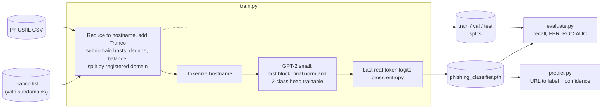

# Phishing URL Classifier

[](https://github.com/Kluey/URL-Phishing-Classifier/actions/workflows/deploy.yml)

Classifies a URL as phishing or legitimate from its **hostname**, by fine-tuning GPT-2 small (124M) on the PhiUSIIL dataset plus legitimate subdomain hosts from the Tranco top-sites list. Only the last transformer block, the final norm and a new 2-class head are trained.

## Setup

```bash
pip install -e .[pretrain]
```

The `pretrain` extra (TensorFlow, requests, tqdm) is needed to download the GPT-2 weights for training. Evaluation and prediction only need `pip install -e .`.

Download the [PhiUSIIL Phishing URL dataset](https://archive.ics.uci.edu/dataset/967/phiusiil+phishing+url+dataset) and place it at `data/PhiUSIIL_Phishing_URL_Dataset.csv`. The pinned Tranco list is downloaded automatically when the splits are built.

## Usage

```bash
python scripts/train.py --prepare-data            # builds splits, trains, saves model/phishing_classifier.pth
python scripts/evaluate.py                        # metrics on the test split
python scripts/evaluate.py --split real_world     # everyday URLs, prints the ones it gets wrong
python scripts/predict.py <url> [<url> ...]       # classify URLs
```

Run `python scripts/train.py --help` or `python scripts/evaluate.py --help` for options.

Training takes about 2.5 minutes on a Colab GPU and hours on a CPU. `notebooks/train_colab.ipynb` runs the whole pipeline on a Colab GPU runtime, and `notebooks/test_predict.ipynb` checks a downloaded model locally.

## How it works



The model sees only the lowercase hostname without a leading `www.` (`components/preprocessing.py`): `https://www.Example.com/login?next=/` becomes `example.com`. The section below explains why.

## Results

Test set: 34,329 hostnames (balanced phishing / legitimate) from registered domains that never appear in training. Phishing is the positive class.

| Metric (threshold 0.5) | Value |
|---|---|
| Accuracy | 80.37% |
| Phishing precision | 0.885 |
| Phishing recall | 0.723 |
| False positive rate | 10.54% |
| ROC-AUC | 0.887 |
| PR-AUC | 0.915 |
| MCC | 0.622 |
| Recall at 1% FPR | 0.487 |
| Recall at 0.1% FPR | 0.313 |

Threshold trade-off. A higher threshold flags fewer URLs. **0.8 is the recommended threshold for warning users**, since a false warning on a legitimate site costs more than a missed one in a browser.

| Threshold | Phishing recall | False positive rate | Precision |
|---|---|---|---|
| 0.3 | 0.845 | 27.7% | 0.774 |
| 0.5 | 0.723 | 10.5% | 0.886 |
| 0.7 | 0.619 | 4.0% | 0.945 |
| 0.8 | 0.566 | 2.4% | 0.964 |
| 0.9 | 0.496 | 1.1% | 0.980 |

**Real-world check** (`eval/real_world_urls.csv`): 50 everyday legitimate URLs with paths and subdomains, plus 20 made-up phishing-style URLs. At 0.5 the model flags 2 of the 50 legitimate URLs (`google.com`, `zoom.us`) and catches all 20 phishing ones. At 0.8 it flags none of the legitimate URLs and still catches all 20.

Setup: 119,540 train / 13,933 validation / 34,329 test hostnames, 2 epochs, batch size 32, learning rate 1e-3 for the head and 5e-5 for the last block and final norm. Validation accuracy of the saved checkpoint: 77.79%.

Fine-tuning more of GPT-2 did not help. Training the last 6 blocks for 3 epochs raised validation accuracy to 79.27%, but test accuracy fell to 78.64% and it flagged 5 of the 50 real-world legitimate URLs (including `github.com` and `amazon.com`). Its training accuracy of 94% points to memorization. The 1-block model was kept. That choice was made after seeing test results, so both models' numbers are reported here.

## Lessons: three shortcuts behind good-looking scores

Each version below scored well on its own test set and failed on real URLs. The fix each time was in the data, not the model.

1. **A 99.6% score on a random split.** The same site flipped between phishing and legitimate depending on whether `https://` or `www.` was present, and a random split put URLs from the same site in both train and test. Fix: strip the scheme and `www.`, and split by registered domain so every test site is unseen.
2. **"Has a path = phishing".** Every legitimate URL in PhiUSIIL is a bare hostname, with no path or query, so the model learned that any path means phishing. It scored 87.65% on the test split, but called `en.wikipedia.org/wiki/Phishing` phishing at 98.9% and `amazon.com/dp/...` at 99.5%. Fix: classify the hostname only.
3. **"Has a subdomain = phishing".** In PhiUSIIL, 55% of phishing hostnames have a subdomain, against 3% of legitimate ones. Its labels also apply to whole URLs, so a phishing form on Google Docs made `docs.google.com` and even `accounts.google.com` "phishing". The hostname model flagged `mail.google.com` at 100%. Fix: add 82,910 legitimate subdomain hosts from Tranco (at most 5 per registered domain, leaving out free-hosting platforms such as `web.app` that mostly host phishing), and drop phishing rows whose hostname is a top-100k Tranco site (3,621 URLs).

| Version | Test accuracy | Real-world legitimate URLs flagged |
|---|---|---|
| Raw URLs, random split | 99.60% | not measured |
| Full URLs, domain split | 87.65% | 6 of 7 in a spot check of URLs with paths |
| Hostname only, PhiUSIIL | 85.76% | 16 of 50 |
| Hostname, PhiUSIIL + Tranco | 80.37% | 2 of 50 |

Each version has its own test set, so test accuracy is not comparable down the column. The last two use the same real-world list. Test accuracy went down as the data got more realistic: the harder test set now contains legitimate subdomains.

## Limitations

- **Hostname only.** No path, page content, domain age or reputation. Phishing pages on shared platforms (`sites.google.com`, `*.web.app`) can't be told apart from legitimate pages there.
- **Popular sites score unevenly.** `google.com` (no legitimate examples in PhiUSIIL) is flagged at 0.5, and `github.com` is only 57% legitimate. A deployed checker should trust a list of popular registered domains and skip private addresses (`192.168.1.1` scores 97% phishing).
- **Recall at a useful threshold.** At 0.8, about 43% of phishing hostnames in the test split are missed.
- **Balanced test set.** Real traffic is mostly legitimate, so precision in practice would be lower than reported.
- **Synthetic phishing in the real-world check.** The 20 phishing URLs there are made up and easy. Only the legitimate half reflects real browsing.

## Tests

```bash
pip install -e .[dev]
pytest
```

## Project structure

```
components/   model, data, training, metrics, evaluation, inference
scripts/      train.py  evaluate.py  predict.py
tests/        unit tests
eval/         real-world URL check (tracked)
notebooks/    Colab GPU training, local model check
data/         raw dataset, Tranco list and splits (not tracked)
model/        trained weights (not tracked) and run metrics
```

## Acknowledgements

Parts of the model implementation are based on and adapted from
Sebastian Raschka's *Build a Large Language Model (From Scratch)*.
The original code is licensed under the Apache License, Version 2.0.

Data: the [PhiUSIIL Phishing URL dataset](https://archive.ics.uci.edu/dataset/967/phiusiil+phishing+url+dataset) (UCI Machine Learning Repository), and the [Tranco list](https://tranco-list.eu/) (list ID `V355N`): Le Pochat et al., *Tranco: A Research-Oriented Top Sites Ranking Hardened Against Manipulation*, NDSS 2019.
