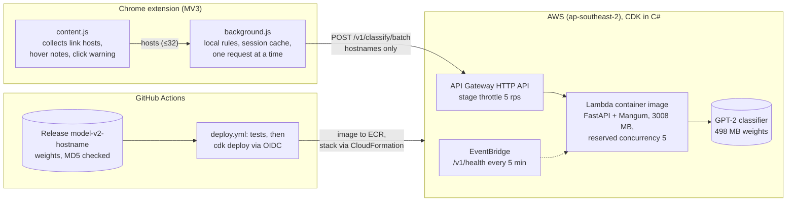

# Phishing URL Classifier

[](https://github.com/Kluey/URL-Phishing-Classifier/actions/workflows/deploy.yml)

A Chrome extension that warns you before you open a link whose hostname looks like phishing. The verdict comes from GPT-2 small (124M), fine-tuned to classify a hostname as phishing or legitimate. The model runs behind a public HTTP API on AWS Lambda. The infrastructure is defined with AWS CDK in C# and deployed by GitHub Actions.


The model and its training data are covered further down, in [The model](#the-model). It is trained on the PhiUSIIL dataset plus legitimate subdomain hosts from the Tranco top-sites list, and only the last transformer block, the final norm and a new 2-class head are trained.

## Architecture



For each link on a page, the extension first decides locally whether the API needs to be asked at all:

| Verdict | When | API called? | What you see |
|---|---|---|---|
| `skip` | private or local hosts (`192.168.1.1`, `printer.local`, `[::1]`, ...) and same-site links | no | nothing |
| `user` | sites you chose "Always allow" for in the popup | no | nothing |
| `shared` | 698 shared hosting, form, dynamic DNS and shortener domains (`web.app`, `sites.google.com`, `bit.ly`, ...) | no | a grey note: anyone can publish there |
| `allow` | 9,868 popular registered domains (Tranco top 10k minus shared platforms) and their subdomains | no | nothing |
| `check` | everything else | yes, unless cached | a red badge on hover and a warning on click if `p_phishing ≥ 0.8` |

Results are cached for 24 hours in `chrome.storage.session`. A click on a link whose verdict is still pending is held for up to 300 ms and then either warned about or let through. If the API is unreachable, the verdict is `unknown` and links work normally: the extension never blocks browsing because the API is down.

## Chrome extension

### Install

The extension isn't on the Chrome Web Store. To load it unpacked:

1. Clone this repository.
2. Open `chrome://extensions`, turn on **Developer mode** and click **Load unpacked**.
3. Select the `extension/` folder. The `key` in `manifest.json` pins the extension ID to `hdbiiiigdjncnfleckifapdpdccmdkng`.

It calls the deployed API out of the box. To try it, serve the demo page and open `http://localhost:8000/demo.html` (content scripts don't run on `file://`):

```bash
python -m http.server -d extension 8000
```

The demo page has allowlisted, shared, private and phishing-style links, plus a link that is added 2 s after the page loads. The phishing hostnames are made up, but someone could register one, so only choose "Open anyway" if you mean to.

The popup shows the verdict for the current site, a switch to turn warnings off, and "Always allow" for the site. The toolbar icon gets a red `!` badge when the page you are on looks like phishing.

### Privacy

- **Only hostnames leave the browser.** `https://www.example.com/account?id=42` is sent as `example.com`, never with the path, query or credentials.
- **Most hostnames are never sent.** Allowlisted, shared, private, user-allowed and cached hosts are decided locally. On a typical news or reference page, only a few unfamiliar hosts are sent (Wikipedia, 1,208 links: 27 hosts in 3 requests).
- **What is sent:** the hosts of links on the pages you visit, and the host of the page itself (for the toolbar badge), when they need checking.
- **Nothing is logged.** The API logs request counts and latency only, for example `classify n=14 ms=1102`. This was checked by searching the CloudWatch logs for the hostnames sent during testing.
- No cookies, no API key, no user ID. The API sends no CORS headers, so web pages can't call it from your browser and read the answers: only the extension's service worker can.

## API

Base URL: `https://vktjpkafxf.execute-api.ap-southeast-2.amazonaws.com`. No API key is needed. Interactive docs are at [`/docs`](https://vktjpkafxf.execute-api.ap-southeast-2.amazonaws.com/docs).

### `GET /v1/health`

```bash
curl https://vktjpkafxf.execute-api.ap-southeast-2.amazonaws.com/v1/health
```
```json
{"status":"ok","threshold":0.8}
```

### `POST /v1/classify`

```bash
curl -X POST https://vktjpkafxf.execute-api.ap-southeast-2.amazonaws.com/v1/classify \
  -H 'content-type: application/json' -d '{"host":"paypal-login-verify.xyz"}'
```
```json
{"host":"paypal-login-verify.xyz","p_phishing":0.999993085861206,"label":"Phishing","threshold":0.8}
```

A full URL is accepted and reduced to its hostname. The response's `host` is always the normalized hostname, so clients can cache by it:

```bash
curl -X POST https://vktjpkafxf.execute-api.ap-southeast-2.amazonaws.com/v1/classify \
  -H 'content-type: application/json' -d '{"host":"https://www.Wikipedia.org/wiki/Phishing"}'
```
```json
{"host":"wikipedia.org","p_phishing":0.015515624545514584,"label":"Legitimate","threshold":0.8}
```

### `POST /v1/classify/batch`

Up to 32 hosts. Results come back in the same order. A bad item gets its own `error` and doesn't fail the rest; its `host` echoes the raw input, so match results by position.

```bash
curl -X POST https://vktjpkafxf.execute-api.ap-southeast-2.amazonaws.com/v1/classify/batch \
  -H 'content-type: application/json' \
  -d '{"hosts":["github.com","secure-appleid-unlock-support.net","///"]}'
```
```json
{"threshold":0.8,"results":[
  {"host":"github.com","p_phishing":0.4256540536880493,"label":"Legitimate","error":null},
  {"host":"secure-appleid-unlock-support.net","p_phishing":0.9987806677818298,"label":"Phishing","error":null},
  {"host":"///","p_phishing":null,"label":null,"error":"Input has no hostname"}]}
```

### Limits and errors

| Case | Response |
|---|---|
| `host` longer than 253 characters (the raw input, so send hostnames, not long URLs) | 422 |
| Input with no hostname (`{"host":"///"}`) | 422 `{"detail":"Input has no hostname"}` |
| More than 32 hosts in a batch, or an empty batch | 422 |
| Body over 16 KB | 413 |
| Unknown path | 404 |
| Over the throttle limit | 429 or 503 (see [Throttling](#throttling)) |

`label` is `Phishing` when `p_phishing ≥ threshold`. The threshold is 0.8 (the `THRESHOLD` environment variable): at 0.8 the model misses more phishing than at 0.5, but a false warning on a legitimate site costs more in a browser than a missed one (see [Results](#results)).

## Deployment on AWS

`infra/` is a CDK app in C# with one stack, `PhishingApi`:

- A **Lambda function from a container image** (`api/Dockerfile`, based on `public.ecr.aws/lambda/python:3.12`): CPU-only PyTorch, the API code and the weights. 3008 MB of memory (2 vCPUs), a 29 s timeout and reserved concurrency of 5.
- An **API Gateway HTTP API** whose `$default` route sends everything to Lambda, so FastAPI does the routing. Stage throttling: 5 requests per second, burst 5.
- An **EventBridge rule** that calls `/v1/health` every 5 minutes to keep one instance warm.
- A CloudWatch log group with 2-week retention.

`infra/test/Infra.Tests` has xUnit tests on the synthesized template (memory, concurrency, throttling, the warmup rule, no CORS).

### CI/CD

- **`ci.yml`** (pull requests): pytest against the pinned API dependencies, the extension's `node --test` suite, and `dotnet test` plus `cdk synth` for the infrastructure.
- **`deploy.yml`** (push to `master`): runs `ci.yml`, then, in the `production` environment, assumes an AWS role through GitHub OIDC (no stored AWS keys), downloads the weights from the [`model-v2-hostname`](https://github.com/Kluey/URL-Phishing-Classifier/releases/tag/model-v2-hostname) release, checks their MD5, runs `cdk deploy`, and smoke-tests the deployed API. The smoke test retries for about 3 minutes, because the first requests after a deploy can hit cold instances.

The weights (498 MB) are a release asset rather than a Git file, and every Python package in the image is pinned in `api/requirements.txt`, so rebuilds are reproducible.

### Performance

Measured on the deployed API unless noted.

| | |
|---|---|
| Warm request, one host | ~0.27 s round trip; 36 to 217 ms inside Lambda |
| Batch of 32 hosts | ~2.8 s (one host at a time, 2 threads) |
| Cold start | init 9.6 to 9.9 s (`import torch` 3.3 s + loading the weights 6.1 s); first response after 10 to 15 s |
| Image | 2.0 GB unpacked, 0.92 GB compressed in ECR |
| Deployed vs local model | max \|Δp\| = 7e-6 over the 70 real-world hosts; same verdicts |

Loading the weights takes 1.5 s locally, so most of the 6 s cold load is Lambda reading the image lazily. Lambda allows 10 s for init, so a cold start sometimes runs over and re-runs init inside the first request, which still fits in the 29 s timeout. Before the warmup rule was added, most cold starts failed with a 503; with it, there is almost always a warm instance. The extension also expects cold starts: its first request times out after 3 s (plus 100 ms per host), but it starts an instance, and one retry with a longer timeout finds it.

### Throttling

Reserved concurrency (5) caps how many requests run at once, and the stage throttle (5 rps, burst 5) caps the sustained rate. In a test with 50 simultaneous requests, 5 got 200, 1 got 429 and 44 got 503. HTTP API throttling is best-effort, so a burst that arrives all at once mostly gets past the stage, and Lambda then rejects what it can't run. API Gateway returns Lambda's throttling as 503, not 429. Those 503s are fast and cost nothing, and no hostnames are logged. The extension sends one request at a time across all tabs, retries 5xx and 429 once, and after a request that fails even on retry, stops calling the API for 30 s.

### Cost

About $0 when idle. Lambda and HTTP API are billed per request, and the warmup's ~8,640 calls a month fit in Lambda's free tier. The only fixed cost is ECR storage: about $0.10 per GB per month, so ~$0.09 a month for the current image. CDK pushes a new image when the API code changes and doesn't delete the old ones, so clean up the asset repository now and then.

### Deploy your own

You need an AWS account, Docker, the .NET 8 SDK, Node.js and the [GitHub CLI](https://cli.github.com/).

```bash
gh release download model-v2-hostname --pattern phishing_classifier.pth --dir model
cd infra                                    # cdk must run from infra/: the image context is its parent
npx aws-cdk@2.1135.1 bootstrap
npx aws-cdk@2.1135.1 deploy PhishingApi     # prints ApiUrl
```

Then put the new `ApiUrl` in `extension/config.js` and in `host_permissions` in `extension/manifest.json` (a test checks that they match). `cdk deploy -c warmup=false` leaves out the warmup rule.

To deploy from GitHub Actions, create the OIDC identity provider and a role in IAM by hand. It isn't in CDK, because an organization policy on the original account denies `iam:*OpenIDConnectProvider*` even to CloudFormation. The role only needs `sts:AssumeRole` on the `cdk-hnb659fds-*` bootstrap roles. If the repository uses GitHub's immutable OIDC subjects, the trust policy's `sub` must use the ID form (`repo:<owner>@<id>/<repo>@<id>:environment:production`); the name form fails with "Not authorized to perform sts:AssumeRoleWithWebIdentity". Then add a `production` environment limited to `master` and a repository variable `AWS_DEPLOY_ROLE_ARN`.

## Design decisions

| Decision | Choice | Why |
|---|---|---|
| Hosting | Lambda container image behind an HTTP API | Costs nothing when idle. The image fits PyTorch and the weights (Lambda zip packages are limited to 250 MB). |
| Model input | Hostname only | The training data has no legitimate URLs with paths, so a path-aware model learns "has a path = phishing" (see [Lessons](#lessons-three-shortcuts-behind-good-looking-scores)). It also means less data leaves the browser. |
| Threshold | 0.8 | A false warning on a legitimate site costs more than a missed phishing link. At 0.8 the model flags 2.4% of legitimate test hostnames, against 10.5% at 0.5. |
| Allowlist before the model | Tranco top 10k registered domains | Popular sites can score badly (`google.com` 0.71, `github.com` 0.43), and they are rarely phishing hosts themselves. It also saves API calls. |
| Shared platforms | A neutral note, no model call | On `web.app` or `sites.google.com`, anyone can publish. The hostname alone can't tell a phishing page there from a real one, so the extension says so instead of guessing. |
| Private and local hosts | Never sent | They say nothing about phishing (`192.168.1.1` scores 0.97), and sending them would leak details of your network. |
| Auth | No API key | A key shipped in an extension is public anyway. Abuse is limited by throttling, reserved concurrency and a strict request schema. |
| CORS | None | The extension calls the API from its service worker with `host_permissions`, which doesn't need CORS. Web pages can't read the answers. |
| Weights | GitHub release asset, fp32 | Keeps 498 MB out of Git. A smaller fp16 or quantized model would be a model change, and the metrics would have to be measured again. |
| OIDC role | Created by hand | An organization policy blocks managing OIDC providers through CloudFormation. |
| Warmup | On | Without it, most cold starts ran over Lambda's init limit and the first requests failed. |

## The model

### Setup

```bash
pip install -e .[pretrain]
```

The `pretrain` extra (TensorFlow, requests, tqdm) is needed to download the GPT-2 weights for training. Evaluation and prediction only need `pip install -e .`, and running the API locally needs `pip install -e .[dev,api]`.

Download the [PhiUSIIL Phishing URL dataset](https://archive.ics.uci.edu/dataset/967/phiusiil+phishing+url+dataset) and place it at `data/PhiUSIIL_Phishing_URL_Dataset.csv`. The pinned Tranco list is downloaded automatically when the splits are built. To skip training, download the trained weights instead:

```bash
gh release download model-v2-hostname --pattern phishing_classifier.pth --dir model
```

### Usage

```bash
python scripts/train.py --prepare-data            # builds splits, trains, saves model/phishing_classifier.pth
python scripts/evaluate.py                        # metrics on the test split
python scripts/evaluate.py --split real_world     # everyday URLs, prints the ones it gets wrong
python scripts/predict.py <url> [<url> ...]       # classify URLs
uvicorn api.main:app                              # the API on http://127.0.0.1:8000
```

Run `python scripts/train.py --help` or `python scripts/evaluate.py --help` for options.

Training takes about 2.5 minutes on a Colab GPU and hours on a CPU. `notebooks/train_colab.ipynb` runs the whole pipeline on a Colab GPU runtime, and `notebooks/test_predict.ipynb` checks a downloaded model locally.

### How it works


The model sees only the lowercase hostname without a leading `www.` (`components/preprocessing.py`): `https://www.Example.com/login?next=/` becomes `example.com`. The Lessons section explains why.

### Results

Test set: 34,329 hostnames (balanced phishing / legitimate) from registered domains that never appear in training. Phishing is the positive class.

| Metric (threshold 0.5) | Value |
|---|---|
| Accuracy | 80.37% |
| Phishing precision | 0.885 |
| Phishing recall | 0.723 |
| False positive rate | 10.54% |
| ROC-AUC | 0.887 |
| PR-AUC | 0.915 |
| MCC | 0.622 |
| Recall at 1% FPR | 0.487 |
| Recall at 0.1% FPR | 0.313 |

Threshold trade-off. A higher threshold flags fewer URLs. **0.8 is the recommended threshold for warning users**, since a false warning on a legitimate site costs more than a missed one in a browser.

| Threshold | Phishing recall | False positive rate | Precision |
|---|---|---|---|
| 0.3 | 0.845 | 27.7% | 0.774 |
| 0.5 | 0.723 | 10.5% | 0.886 |
| 0.7 | 0.619 | 4.0% | 0.945 |
| 0.8 | 0.566 | 2.4% | 0.964 |
| 0.9 | 0.496 | 1.1% | 0.980 |

**Real-world check** (`eval/real_world_urls.csv`): 50 everyday legitimate URLs with paths and subdomains, plus 20 made-up phishing-style URLs. At 0.5 the model flags 2 of the 50 legitimate URLs (`google.com`, `zoom.us`) and catches all 20 phishing ones. At 0.8 it flags none of the legitimate URLs and still catches all 20. The deployed API gives the same results (`scripts/check_deployed.py`).

Setup: 119,540 train / 13,933 validation / 34,329 test hostnames, 2 epochs, batch size 32, learning rate 1e-3 for the head and 5e-5 for the last block and final norm. Validation accuracy of the saved checkpoint: 77.79%.

Fine-tuning more of GPT-2 did not help. Training the last 6 blocks for 3 epochs raised validation accuracy to 79.27%, but test accuracy fell to 78.64% and it flagged 5 of the 50 real-world legitimate URLs (including `github.com` and `amazon.com`). Its training accuracy of 94% points to memorization. The 1-block model was kept. That choice was made after seeing test results, so both models' numbers are reported here.

### Lessons: three shortcuts behind good-looking scores

Each version below scored well on its own test set and failed on real URLs. The fix each time was in the data, not the model.

1. **A 99.6% score on a random split.** The same site flipped between phishing and legitimate depending on whether `https://` or `www.` was present, and a random split put URLs from the same site in both train and test. Fix: strip the scheme and `www.`, and split by registered domain so every test site is unseen.
2. **"Has a path = phishing".** Every legitimate URL in PhiUSIIL is a bare hostname, with no path or query, so the model learned that any path means phishing. It scored 87.65% on the test split, but called `en.wikipedia.org/wiki/Phishing` phishing at 98.9% and `amazon.com/dp/...` at 99.5%. Fix: classify the hostname only.
3. **"Has a subdomain = phishing".** In PhiUSIIL, 55% of phishing hostnames have a subdomain, against 3% of legitimate ones. Its labels also apply to whole URLs, so a phishing form on Google Docs made `docs.google.com` and even `accounts.google.com` "phishing". The hostname model flagged `mail.google.com` at 100%. Fix: add 82,910 legitimate subdomain hosts from Tranco (at most 5 per registered domain, leaving out free-hosting platforms such as `web.app` that mostly host phishing), and drop phishing rows whose hostname is a top-100k Tranco site (3,621 URLs).

| Version | Test accuracy | Real-world legitimate URLs flagged |
|---|---|---|
| Raw URLs, random split | 99.60% | not measured |
| Full URLs, domain split | 87.65% | 6 of 7 in a spot check of URLs with paths |
| Hostname only, PhiUSIIL | 85.76% | 16 of 50 |
| Hostname, PhiUSIIL + Tranco | 80.37% | 2 of 50 |

Each version has its own test set, so test accuracy is not comparable down the column. The last two use the same real-world list. Test accuracy went down as the data got more realistic: the harder test set now contains legitimate subdomains.

## Limitations

- **Hostname only.** No path, page content, domain age or reputation. Phishing pages on shared platforms (`sites.google.com`, `*.web.app`) can't be told apart from legitimate pages there, which is why the extension shows a neutral note for them.
- **Popular sites score unevenly.** `google.com` (no legitimate examples in PhiUSIIL) scores 0.71, and `github.com` 0.43. The extension's allowlist covers them, but a client calling the API directly should do the same, and skip private addresses (`192.168.1.1` scores 0.97).
- **Recall at a useful threshold.** At 0.8, about 43% of phishing hostnames in the test split are missed.
- **Balanced test set.** Real traffic is mostly legitimate, so precision in practice would be lower than reported.
- **Synthetic phishing in the real-world check.** The 20 phishing URLs there are made up and easy. Only the legitimate half reflects real browsing.
- **Extension coverage.** Only link clicks are checked. "Open link in new tab" from the context menu, dragging a link, and typing a URL bypass the warning (the toolbar badge still flags a phishing page once it loads). A click held while a verdict is pending is replayed with `a.click()`, which a page can tell apart from a real click.
- **Cold starts and outages.** If no instance is warm and the retry fails too, the page's links get `unknown` and aren't warned about until they are checked again, on the next hover after 30 s.

## Tests

```bash
pip install -e .[dev,api]
pytest                                  # model, data pipeline and API
node --test "extension/tests/*.test.js" # extension rules, API client and lists (Node 22+, no npm install)
dotnet test infra/src/Infra.sln         # CDK template
```

The Python tests use a randomly initialized model, so they need neither the dataset nor trained weights.

## Project structure

```
components/          model, data, training, metrics, evaluation, inference
scripts/             train.py  evaluate.py  predict.py
                     benchmark_inference.py  build_extension_lists.py  check_deployed.py
api/                 FastAPI app, Lambda handler, Dockerfile, pinned requirements
extension/           MV3 extension: content script, service worker, rules, popup, lists, demo page
infra/               CDK app in C# (ApiStack) and template tests
.github/workflows/   ci.yml (pull requests), deploy.yml (master)
tests/               Python unit tests
eval/                real-world URL check (tracked)
notebooks/           Colab GPU training, local model check
assets/              README media
data/                raw dataset, Tranco list and splits (not tracked)
model/               trained weights (not tracked) and run metrics
```

## Acknowledgements

Parts of the model implementation are based on and adapted from
Sebastian Raschka's *Build a Large Language Model (From Scratch)*.
The original code is licensed under the Apache License, Version 2.0.

Data: the [PhiUSIIL Phishing URL dataset](https://archive.ics.uci.edu/dataset/967/phiusiil+phishing+url+dataset) (UCI Machine Learning Repository), and the [Tranco list](https://tranco-list.eu/) (list ID `V355N`): Le Pochat et al., *Tranco: A Research-Oriented Top Sites Ranking Hardened Against Manipulation*, NDSS 2019.
